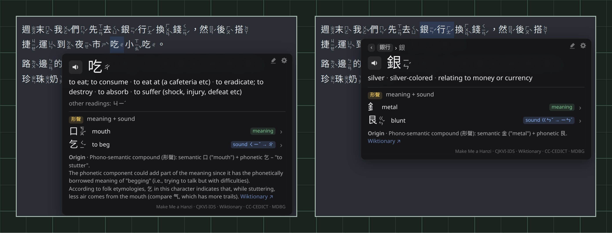
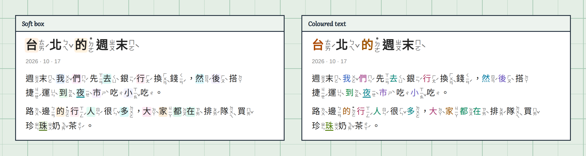
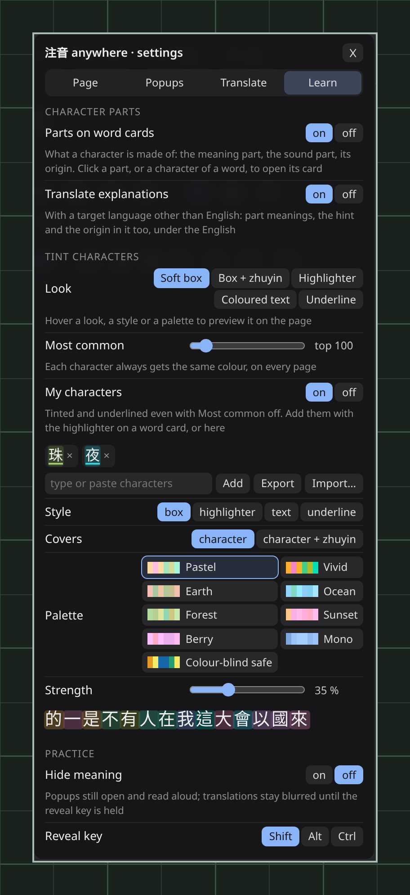

# Changelog

Newest first. Versions are the userscript's `@version`; each entry lists the commits that make it up.

## 0.9.3

**Older parts.** Many common characters have changed so much that their parts can't be seen any more. Their cards used to break them into meaningless shapes (用 as 冂 + 二 + 丨). Now they say so, and show the parts the character was built from: 年 was 禾 (meaning) + 人 (sound), 夜 was 亦 (sound) + 夕 (meaning). Click one to open it.

### `<hash>` · 2026-10-25 · TASK-007 fix(learn): Show older parts instead of shapes when a character's parts changed

- Build: a character whose parts have no meaning or sound role gets no parts (unless Make Me a Hanzi's hint names them all, like 我); 80 形聲/會意 characters such as 用, 平, 年, 金, 青 lose their shape-only split.
- Build: a new `from` column with Wiktionary's parts when the glyph no longer shows them (850 characters: 年 禾 + 人, 星 晶 + 生, 重 人 + 東); they get rows of their own. Single strokes are named as strokes (丨 "vertical stroke", not "number one").
- Card: an "Older parts" line, each part clickable, with its role; the header says "no longer visible in today's form" when a 形聲/會意 character has no meaning or sound part to show.

## 0.9.2

**Your language from the start.** On a fresh install, translations go to your browser's language, with English under it.

**Open a word from the word list.** Select a sentence: every word in the list under the translation has a › at the end. Click it and the word's card takes the popup's place, with all its senses; click a character there to go further in. The path at the top leads back to the sentence.

### `<hash>` · 2026-10-25 · TASK-006 feat(popup): Open a word's card from the translation's word list

- Newcomers get their browser's language: "Translate to" defaults to it, with English as "Second language" (English only for English and Chinese browsers). Settings already chosen stay.
- "Translate explanations" is on by default: with a target language other than English, a character's explanations come in it too.
- README settings table: every setting names its default.
- A › at the end of every word-list row replaces the translation popup with the word's card, under the selection. The crumb starts with the sentence (`我們先去銀… › 我們 › 我`) and brings the translation back. Like the popup, the card stays until a click elsewhere or Esc; hovering or scrolling the page leaves it alone.

## 0.9.1

**Explanations in your language.** With **Learn › Translate explanations** on and a target language other than English, a character's card shows the hint and the origin in that language too, under the English, as well as each part's meaning.

### `a3540d8` · 2026-10-25 · TASK-005 fix(learn): Translate hints and origins, split pictographs their hint describes

- "Translate parts" is now "Translate explanations": the hint and the origin are translated too (from English, one line per target language under the English).
- Pictographs whose Make Me a Hanzi hint names every part show those parts as shapes: 我 = 扌 + 戈, 果 = 田 + 木, 東 = 木 + 日 (72 characters). Pictographs whose hint names nothing still show none (日, 木).
- A sound part from Make Me a Hanzi that the structure only holds nested, and that sounds nothing like the character, is dropped: 蹋 (ㄊㄚˋ) is 足 + 𦐇, and no longer lists 日 (ㄖˋ) as its sound part, so 日's "Sound part in" loses it.
- The what's-new note lists every version since the one last seen, so someone coming from 0.8 still hears about 0.9.0.

## 0.9.0

New things to try. They're all under **Learn** in the settings (⚙ on a word card):

**What a character is made of.** Point at a single character: its card shows the meaning part and the sound part, how the character was formed (形聲, 會意, 象形) and where it comes from. Click a part to open its own card; in the card for a word, click a character.

**Tint the common characters, and your own.** **Most common** tints the top 100 characters, or up to 1000, each always in the same colour. The highlighter on a word card adds a character to **My characters**, tinted and underlined everywhere. Five looks (hover to preview), nine palettes, a strength slider. Export and import your list.

**Settings in tabs**: Page, Popups, Translate, Learn.

### `<hash>` · 2026-10-25 · TASK-004 feat(learn): Add character parts, tinted characters and settings tabs

- Character parts on the word card: one-character cards show how the character was formed, each part with its zhuyin, meaning and role (`meaning`, `sound ㄑㄧˇ → ㄔ`), a hint, the origin from Wiktionary with a link, and the characters a part gives its sound to. Clicking a part, or a character row of a word's card, opens that character's card, with a path (`吃 › 乞`) and ‹ to go back. "Parts on word cards" (on) and "Translate parts" (off: part meanings in the target language too).
- `data/components.tsv.gz` (GPL-3.0-or-later, 227 KiB): Make Me a Hanzi, CJKVI-IDS and Wiktionary glyph origins merged for the MOE's 4,808 common characters and their parts, built by `tools/components/`. Loaded as a new `@resource` the first time a card needs it.
- Tinted characters: "Most common" (0–1000, from the zhuyin dictionary's counts) and "My characters" (saved; highlighter on one-character cards; chips, add, export to a file, additive import). Looks, style (box, highlighter, text, underline), covers (character or character + zhuyin), nine palettes, strength. Colour = FNV-1a hash of the character into the palette; darker on dark pages. The glyph's tint is a `::before` behind it, so nothing on the page moves. Hovering a look, style or palette previews it; the sliders apply on release.
- Settings panel in tabs (Page, Popups, Translate, Learn) with section titles; it stays on screen when a tab is taller. The new options aren't in the Violentmonkey menu; "Settings…" is its first entry.
- No word cards while the translation popup is open.
- A one-time "what's new" note after an update, linking here and to the Learn settings.
- "Update available" note: at most once a day the first kilobyte of the script on `main` is read for its `@version` (new `@connect raw.githubusercontent.com`). If it's newer: Install, What's new, Later, Skip this version.
- Fix: a restarted page (Alt+Z back to `on`) could stay without zhuyin when the browser's idle callback only ever ran on its timeout.
- README: "See how the tool works" with learning tips, new sections and images (`parts.png`, `tint.png`, `settings.png`; tints in `before-after.png` and `hover.png`), the 100 most common characters, how to say 注音. Popup crops in `select.png`, `languages.png` and `hide-meaning.png` no longer cut the popup off.

## 0.8.0

### `<hash>` · 2026-10-18 · TASK-003 feat(zhuyin): Add zhuyin on page on/hover/off and zhuyin beside characters in popups

- "Zhuyin on page": `on`, `hover` or `off`, saved, for all sites. The text stays annotated, so the word card and the translation box work as before. Alt+Z switches between the three instead of a show/hide that was forgotten on reload.
- `hover`: the word under the pointer gets one label with its zhuyin above it, outside the text flow so nothing moves. "Hover zhuyin: in the line" draws it beside the characters instead.
- "Zhuyin in popups": `by each character` (textbook style, the default) or `after the word` in the word card, the selected text (up to 120 characters) and the word list.

## 0.7.0

### `<hash>` · 2026-10-17 · TASK-002 feat(popup): Add settings panel, target languages and hide-meaning mode

- ⚙ on the word card and the translation popup opens a settings panel with every option, applied right away. One settings table drives both the panel and the Violentmonkey menu (all entries kept, plus "Settings…").
- "Translate to": every language Google Translate offers (132, English and Lithuanian first; any other code from the menu), and an optional "Second language" shown under the first. Non-English languages come from Google in the card (word and characters) and the word list too, one batched request each, cached; English keeps CC-CEDICT. With two languages every line is tagged (`LT`, `EN`).
- "Hide meaning": popups open as usual but translations are blurred while the reveal key (Shift, Alt or Ctrl) isn't held; pressing and holding the blurred text also reveals it.
- R reads the open word card, else the translation popup, aloud; only while one is open and not while typing. The letter is a setting, with or without Alt.
- The popup is built with DOM calls instead of `innerHTML`, so it also opens on pages that enforce Trusted Types.
- In-memory translation cache is keyed by language; `local` opus-mt only for English.
- README images: new `languages.png`, `hide-meaning.png`, `settings.png` (dark mode); `hover.png`, `select.png`, `dark.png` retaken with the ⚙. `build.js` replays canned answers per language and line, and dark examples share a `.night` block.

## 0.6.0

### `<hash>` · 2026-10-17 · feat(popup): Add word-list speakers, CC-CEDICT word split, cache, dark theme and touch

- Every row of the selection word list has its own speaker button.
- Segmenter words that CC-CEDICT doesn't list (IME phrases like 我在, 最好的) are split into CC-CEDICT words in the word list and the hover card. The card shows the piece under the pointer, and only that piece is tinted on the page.
- Google translations and voice clips are cached in IndexedDB, per site, 100 MB by default (menu "Cache"; 0 = off), least recently used first out.
- Menu "Popup theme": `auto` (follows the system), `dark` or `light`. New README image `dark.png`.
- Touch: tapping a word opens its card; a long-press selection is translated once it stops changing. Emulated mouse events from taps are ignored.
- `tools/assets/fetch-deps.sh`: progress bar, retries, and skips files it already has.

## 0.5.1

### `<hash>` · 2026-10-17 · fix(popup): Keep hover card closed while drag-selecting text

- Hover card no longer opens for words dragged over while selecting; an open card closes when a button is pressed.
- Translation popup (auto or <kbd>Alt</kbd>+<kbd>T</kbd>) closes any open hover card first, so the card can't sit on top of it.

### `fcb0f08` · 2026-10-17 · docs(readme): Add README image generator and local install instructions

- `tools/assets/`: renders the README images with the real userscript in headless Chromium (Playwright). See `tools/assets/README.md`.
- All `docs/img/` images regenerated with the 0.5.0 card and popup; hover and select crops made taller so the bigger card fits.
- README install section: Violentmonkey store links, installing from a URL, another branch or a local clone, and enabling `file://` pages in the browser and in the script's menu.
- Task template: no attribution trailers in commits, no `TASK-` prefix outside a task, regenerate images on UI changes.
- `.gitignore`: `*.zip`.

## 0.5.0

### `cef5718` · 2026-10-17 · TASK-001 feat(popup): Add read-aloud, larger zhuyin card and pinyin toggle

- Speaker button on the hover card and the translation popup: Google's zh-TW voice via Web Audio, the browser's own voice when Google fails. A second click or <kbd>Esc</kbd> stops it.
- Hover card is larger and always shows the word's zhuyin (20 px).
- Hover card sits 2 px under its word, which is tinted. It stays open when the pointer slips a little off, and isn't taken over by words crossed on the way to it.
- Hover card is placed beside, below or above an open translation popup, never over it.
- Menu toggle "Pinyin in translation", off by default; the word list shows zhuyin instead.
- `@connect translate.google.com` for the voice.
- Task doc and task template in `docs/tasks/`.

### `f94cd78` · 2026-10-17 · TASK-001 feat(popup): Add read-aloud, larger zhuyin card and pinyin toggle

- Only adds `tmp/*` to `.gitignore`; the feature itself is in `cef5718`.

## 0.4.1

### `d652402` · 2026-10-17 · Make work on local files

- `@match file:///*`: the script runs on local HTML files.
- Local files share one setting, "Local files" in the menu, instead of colliding on an empty hostname.

## 0.4.0

### `a67ccdb` · 2026-10-17 · Add readme images

- README images in `docs/img/`.

### `1ecadab` · 2026-10-17 · Initial upload

- Textbook-style zhuyin beside every Traditional Chinese character, word-segmented, with Taiwan readings from McBopomofo via yt-zhuyin's dictionary.
- Hover a word for its CC-CEDICT meaning and the meaning of each character.
- Select text for an English translation (Google, or a local opus-mt server), with pinyin and a word-by-word list.
- Compact mode for buttons and pop-ups, per-site on/off/auto, `side` or `top` layout, polyphone highlighting.
- <kbd>Alt</kbd>+<kbd>Z</kbd> show/hide, <kbd>Alt</kbd>+<kbd>T</kbd> translate, <kbd>Esc</kbd> close.
