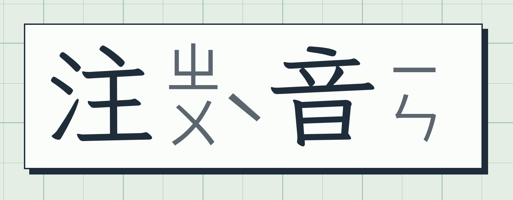
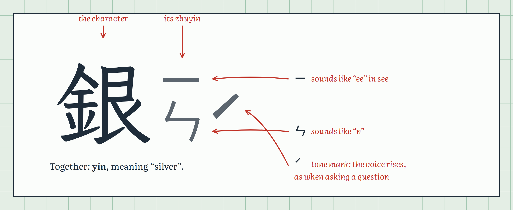
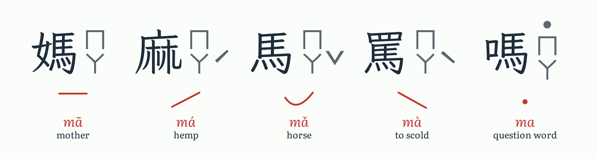
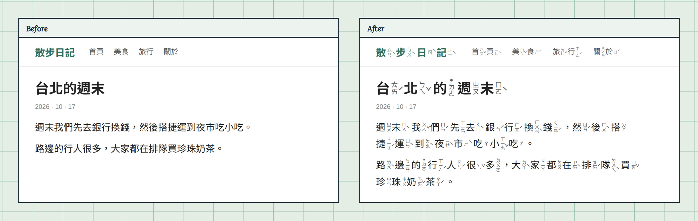
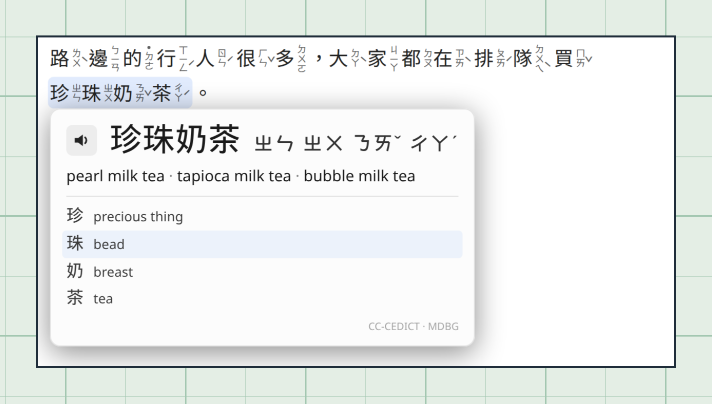
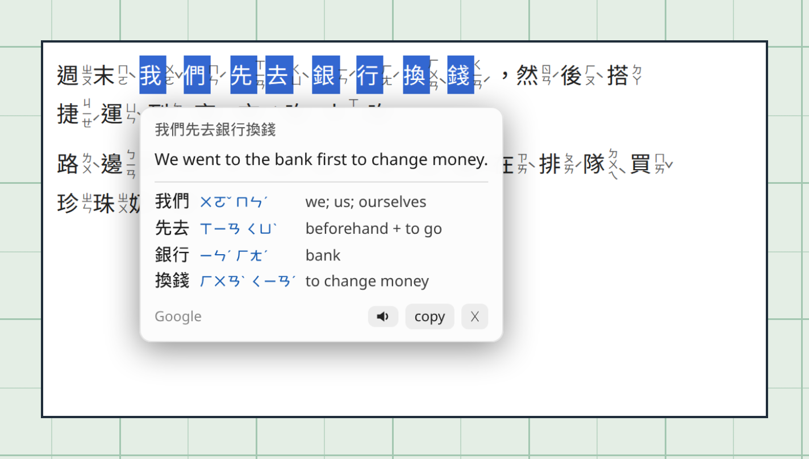
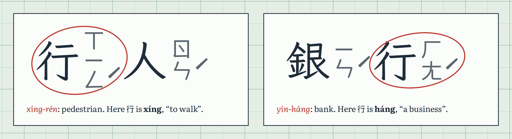
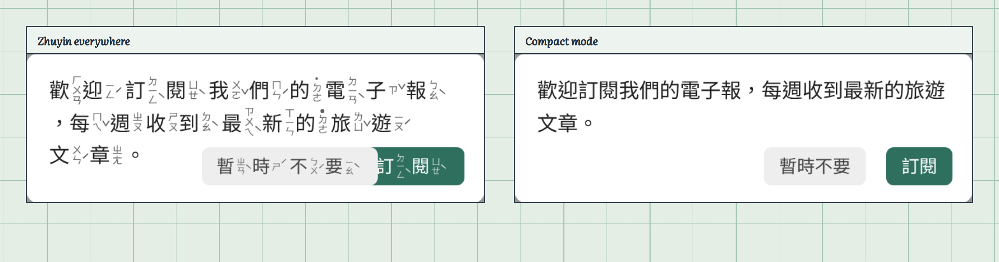

# Zhuyin Anywhere

A Violentmonkey userscript for reading Taiwanese websites while learning Mandarin.

- Writes **zhuyin** (Taiwan's pronunciation symbols) beside every Traditional Chinese character on any page.
- Shows the **English meaning** of a word when you point at it.
- **Translates** whatever text you select.

Works in Firefox and Chrome on news sites, blogs, YouTube and anything else written in Traditional Chinese.

 

## Never seen zhuyin before?

Chinese characters don't tell you how to pronounce them. Children in Taiwan learn pronunciation with **zhuyin** (注音), also called **bopomofo**: 37 sound symbols written in a small column right beside each character. Read the column from top to bottom, then apply the tone mark.

Mandarin has four tones plus a light, neutral one. The same sound said with a different pitch is a different word:

| Mark | Tone | How it sounds |
|---|---|---|
| *(none)* | 1st | high and flat |
| ˊ | 2nd | rises, like asking "yes?" |
| ˇ | 3rd | dips, then comes back up |
| ˋ | 4th | falls sharply |
| ˙ (dot above the column) | neutral | short and light |

## Features

### Zhuyin on every page

When you turn it on, every Traditional Chinese character on the page gets its zhuyin, including headlines, menus, article text and comments. The page itself isn't changed otherwise. When you copy text, you get clean Chinese without the symbols mixed in.

### Point at a word to see what it means

Hovering over a word opens a card with:
- the word with its zhuyin in large print, and a speaker button that reads it aloud,
- the English for the whole word,
- what each character means on its own, with the one under your cursor highlighted.

In this example, "pearls + milk + tea" turns out to be bubble tea.

### Select text to translate it

Highlight any text to get the English translation, with a speaker button that reads the text aloud. Selections of up to 24 characters also get a word-by-word breakdown with each word's zhuyin. Pinyin (the Latin-letter spelling of the same sounds) can be switched on in the menu.

While the translation is open, the word card appears beside it rather than on top of it.

The screenshots come from a demo page. The English sentence in this one was supplied offline, but the word list underneath is real dictionary output.

### It reads words, not single characters

Many characters are pronounced differently depending on the word they're in. The script splits text into dictionary words first, so it picks the reading the word needs. Here 行 is *xíng* ("to walk") in 行人 (pedestrian), but *háng* ("a business") in 銀行 (bank):

### Pop-ups and buttons stay usable

Zhuyin makes text about 40% wider, and small fixed-size boxes weren't designed for that. So the script uses **compact mode** in these places: the text is still annotated, so hovering works and the card shows the zhuyin, but the symbols aren't drawn on the page. Compact mode applies to:
- buttons, tabs and menus,
- anything pinned to the screen, such as pop-ups, toasts and sticky headers,
- any box that would start overflowing once zhuyin is added.

Boxes that already cut their text off on purpose, such as "Read more" previews and one-line titles ending in "…", keep their zhuyin.

## Install

1. Install [Violentmonkey](https://violentmonkey.github.io/) for your browser: [Firefox](https://addons.mozilla.org/firefox/addon/violentmonkey/), [Chrome](https://chrome.google.com/webstore/detail/violentmonkey/jinjaccalgkegednnccohejagnlnfdag) or [Edge](https://microsoftedge.microsoft.com/addons/detail/eeagobfjdenkkddmbclomhiblgggliao).
2. Click **[install zhuyin-anywhere.user.js](https://raw.githubusercontent.com/ashirviskas/zhuyin-anywhere/main/zhuyin-anywhere.user.js)**. Violentmonkey opens its install page; click **Install**. Updates are picked up automatically after that.
3. Open any Traditional Chinese page.

### Other ways to install

- **From a link, by hand:** Violentmonkey icon → ⚙ (dashboard) → **+** → **Install from URL**, and paste the raw link above.
- **A branch other than `main`:** use its raw link, `https://raw.githubusercontent.com/ashirviskas/zhuyin-anywhere/<branch>/zhuyin-anywhere.user.js`. Note that the script's `@updateURL` points at `main`, so auto-update brings you back to `main`.
- **From a local clone:** open `zhuyin-anywhere.user.js` in the browser (drag it into a tab, or open `file:///path/to/zhuyin-anywhere/zhuyin-anywhere.user.js`). Violentmonkey opens its install page. Tick **Track local file before this window is closed** to reinstall on every save while you edit the script. In Chrome this needs file access, see below.

### Local files (`file://` pages)

The script also runs on HTML files opened from disk, but the browser has to let Violentmonkey in first:

- **Chrome / Edge / Brave:** open `chrome://extensions` (`edge://extensions` in Edge) → Violentmonkey → **Details** → turn on **Allow access to file URLs**. Then reload the page.
- **Firefox:** nothing to do; extensions can run on `file://` pages already.

Then in the script itself:

- Local files are treated as one site called *local files*, `auto` by default: zhuyin is added only when the page looks like Traditional Chinese.
- To force it, open the Violentmonkey icon on a local page → this script → **Local files: auto → on**. Or press <kbd>Alt</kbd>+<kbd>Z</kbd> on a page the script skipped.
- The dictionaries come from Violentmonkey's storage, so no network is needed on local pages, except for Google translation and read-aloud.

On install, Violentmonkey downloads two dictionaries once and keeps them in its storage:
- the zhuyin dictionary from [yt-zhuyin](https://github.com/ashirviskas/yt-zhuyin), about 6.5 MB,
- CC-CEDICT from MDBG, about 4 MB gzipped.

Neither is loaded on pages that have no Chinese text. The meaning dictionary is only unpacked the first time you hover over a word, which takes about 200 ms.

## Usage

### Keys

| Key | Action |
|---|---|
| <kbd>Alt</kbd>+<kbd>Z</kbd> | Show or hide zhuyin. On a page the script skipped, this turns it on. |
| <kbd>Alt</kbd>+<kbd>T</kbd> | Translate the selection (when automatic translation is off) |
| <kbd>Esc</kbd> | Close the translation box or word card, and stop reading aloud |

### Menu (Violentmonkey icon → this script)

| Setting | Options |
|---|---|
| This site | `auto` (on when the page looks like Traditional Chinese) → `on` → `off`. Remembered per site. |
| Layout | `side`: textbook style, symbols beside the character. `top`: horizontal, above the character. |
| Highlight polyphones | Tints characters whose reading is a best guess between several options |
| Buttons & popups | `compact` or full zhuyin everywhere |
| Word gloss | `hover`, `alt` (only while holding <kbd>Alt</kbd>), or `off` |
| Translator | `google` (Google's free web endpoint, no key) or `local` (yt-zhuyin's `asr_server.py`, opus-mt, offline) |
| Pinyin in translation | Off: the word list shows zhuyin. On: a pinyin line under the selected text, and pinyin in the word list. |
| Translate on select | On, or off so that only <kbd>Alt</kbd>+<kbd>T</kbd> translates |

## How it works

- **Readings:** the McBopomofo dictionary data with Taiwan (MOE) readings, plus word frequencies, via yt-zhuyin's `zhuyin-dict.js`. Text is split into words with the same unigram max-likelihood segmenter yt-zhuyin uses, so readings come from words rather than single characters.
- **Rendering:**
  - Uses custom elements (`<zy-w>`, `<zy-c>`, `<zy-z>`…) instead of ``, so site CSS aimed at `span` can't touch them.
  - Its selectors are boosted with `:is(#zyh#zyh#zyh, …)` and start from `all: unset`, which overrides `*` and `.content *` rules too.
  - Adds a `<wbr>` after every word, so Firefox can wrap lines between annotated words.
- **Performance:**
  - Text nodes are processed in idle-time slices.
  - A `MutationObserver` picks up content added later (SPAs, infinite scroll, YouTube navigation).
  - Layout is measured in batches: once before and once after each slice. That's what drives the overflow guard behind compact mode.
- **Meanings:** CC-CEDICT, sorted so the entry whose reading matches the zhuyin on the page comes first. That includes CC-CEDICT's "Taiwan pr." notes.
- **UI:** the hover card and translation popup live in a closed shadow root, so page styles can't affect them.

## Known limitations

- **Neutral tones:** McBopomofo stores dictionary tones, so some words show a full tone where textbooks write the neutral ˙. For example, 覺得 shows ㄉㄜˊ instead of ˙ㄉㄜ. The hover card corrects the character breakdown using CC-CEDICT, but the zhuyin on the page stays as the dictionary has it.
- **Word list senses:** the selection word list shows each word's first CC-CEDICT sense, which isn't always the one the sentence uses. 搭 comes out as "to put up", not "to take (the MRT)". The hover card lists more senses.
- **React/Vue sites:** replacing text nodes can crash some single-page apps on their next re-render. If a site breaks, set it to `off` from the menu.
- **Google translation:** the `google` translator uses an unofficial endpoint and can occasionally be rate-limited. The popup then shows an error instead of the translation.
- **Read aloud:** uses Google Translate's unofficial voice endpoint, with a Taiwan Mandarin speaker. When it can't be reached, the browser's own voice reads instead; on Linux that is often espeak-ng, which sounds robotic. The button's tooltip says when that happened and why. Google chooses the reading itself, so a single character can come out differently from the zhuyin on the page.
- **Simplified Chinese:** pages in Simplified Chinese are skipped in `auto` mode, because the dictionary covers Traditional characters.

## Related

[yt-zhuyin](https://github.com/ashirviskas/yt-zhuyin) is a YouTube transcript panel with the same zhuyin rendering, and it's where this script's dictionary comes from. The two scripts can run side by side: this one doesn't annotate yt-zhuyin's panel.

## Credits and license

MIT, see [`LICENSE`](LICENSE).

- **Zhuyin readings:** [McBopomofo](https://github.com/openvanilla/McBopomofo) dictionary data (MIT), via yt-zhuyin. The script downloads it at install; this repo doesn't include it.
- **Word meanings:** [CC-CEDICT](https://cc-cedict.org/) by MDBG ([CC BY-SA 4.0](https://creativecommons.org/licenses/by-sa/4.0/)). Also downloaded at install, not included here.
- **Fonts in the README images:** LXGW WenKai TC and Literata, both under the SIL Open Font License.

## Images in this README

The images are rendered from [`tools/assets/`](tools/assets/), which runs the real userscript in headless Chromium. Run `node build.js` there to regenerate them after changing the script.
