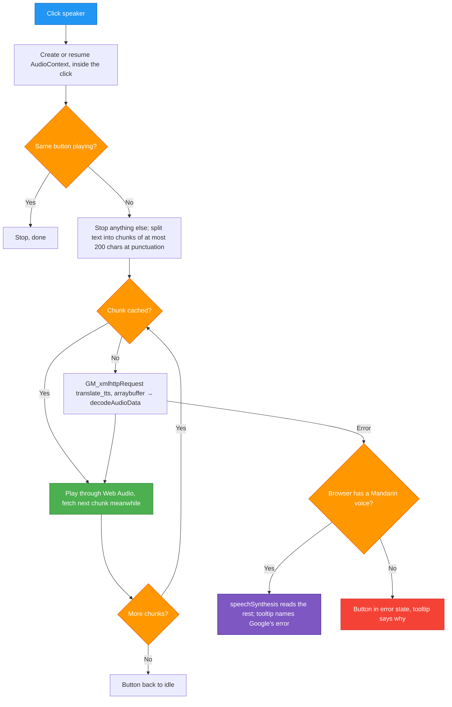

# TASK-001: Read aloud, larger hover card, pinyin off by default — progress

Status: **Implemented, not tested in a browser (2026-10-17, last change 001.11).** All code and the README are written; `node --check` passes, and the chunking and the hover card placement were checked with node. Testing in Violentmonkey (001.5) and retaking two README screenshots are open. Not committed.

## Full initial request (verbatim)

> Please add button inside popup to read the word aloud. First, analyze and present me options. Evaluate each in a nice table. Create task and task template like in my fork of rnote which you can find in ../rnote/docs/tasks/

> Do A with offline backup of browser built in. Wdyt? Should be best useability.

> Evaluate this please

> Ok and also show zhuyin in the hover pop up, this one bigger than the one in text for better readability. And pop up could be bigger too.

> And don't show pinyin in the sentence translation, unless pinyin enabled too somehow. And when sentence translation active on marked, the on hover should not get in the way please. Maybe below or other side, but NOT over the sentence translation

> Should ave updated task progress file with commit and no bs leftover from task template pls

> One more thing - card on hover very easily disappears if mouse goes a little away. And make speaker button on the left, so that there's less mouse travel if hovering over character and want to hear it.

> Sometimes mouse going down to the hover pop up still activates hover on the symbol below. See file:///home/mati/projects/little_price_zh_tw/build/le-petit-prince.html Maybe it is too far away? [screenshot: card for 道歉 opened below the word, over the next line]

> Bug fixed, but still a bit too much space maybe. Also would be cool to slightly somehow highlight or mark the word that is being hovered on rn

## Read first

- Project rules: never `git stash`, never run `git commit` (print a Suggested commit block instead), temporary files only in `./tmp/`, KISS, one file (`zhuyin-anywhere.user.js`) and no build step, reuse the popup's existing CSS classes and light/dark colours, no backwards compatibility.
- `README.md`: the features, keys and menu tables.
- The pipeline comment at the top of `zhuyin-anywhere.user.js`: step 7 is the read-aloud part.

## Overview

1. **Read aloud.** A speaker button on the hover card (reads the word) and in the translation popup's bar (reads the selection). Google's Taiwan Mandarin voice; the browser's own voice when Google can't be reached.
2. **Hover card.** The word's zhuyin is always shown, at 20px; the whole card is bigger.
3. **Pinyin.** Off by default in the translation popup, behind a menu toggle; the word list shows zhuyin instead.
4. **Placement.** The hover card never opens on top of an open translation popup.
5. **Hover card stays put.** Slipping a little off the word or card no longer closes it; the card's speaker is on the left, right under the word.

## User decisions (precise wording)

| Topic | Decision (user's words) |
|---|---|
| Where | "button inside popup" → a speaker button in the shadow-DOM popups |
| Voice source | "Do A with offline backup of browser built in" → Google `zh-TW` voice first, `speechSynthesis` when Google fails |
| Priority | "Should be best useability" → a click always makes a sound when any Mandarin voice exists |
| Hover card zhuyin | "show zhuyin in the hover pop up, this one bigger than the one in text" → always shown (before: only for compact text or after Alt+Z), 20px; on the page it is half the text size, so 8px on 16px text |
| Hover card size | "pop up could be bigger too" → hover card only; the translation popup keeps its size |
| Pinyin | "don't show pinyin in the sentence translation, unless pinyin enabled too somehow" → menu toggle "Pinyin in translation", off by default; off also turns the word list's reading column into zhuyin |
| Placement | "NOT over the sentence translation" → the card tries below the word, above it, right of the popup, left of it, below it, above it; overlaps only when the window fits none of these |
| Card closing | "card on hover very easily disappears if mouse goes a little away" → hide after 400ms off the word and card (was 200ms), and not while the pointer is within 40px of either |
| Moving to the card | "mouse going down to the hover pop up still activates hover on the symbol below" → words crossed on the way to the card never take it over (bug fix + the strip between word and card ignores other words) |
| Gap to the card | "still a bit too much space maybe" → the card sits 2px from its word (was 8px); the translation popup keeps 8px |
| Hovered word | "slightly somehow highlight or mark the word that is being hovered" → the word of the open card gets a light blue tint, gone when the card closes |
| Speaker position | "make speaker button on the left, so that there's less mouse travel" → first in the card's headword row, larger click target (18px icon, 6px padding) |
| Which popups, button look, hotkey | Not answered; recommendations taken: both popups, inline SVG speaker in `currentColor`, no hotkey |

## Decisions needed

None. The user can still overrule the three recommendations in the last row above.

## Design principles
- **No backwards compatibility** - Clean implementation, update all code in place
- KISS
- Elegant
- One `speak(text, btn)` used by both popups; the buttons only call it.
- The voice must sound like Taiwan Mandarin, since the zhuyin on the page uses Taiwan readings.
- The learner reads zhuyin; pinyin only on request.

---

## Analysis

Before this task there was no audio in the script, the hover card showed zhuyin only where the page did not, and the translation popup always showed pinyin.

Measured on this machine (Fedora 44): speech-dispatcher's only output module is `espeak-ng`, whose Mandarin voice is `cmn`. There is no `zh-TW` voice. Firefox's Web Speech API on Linux speaks through speech-dispatcher, so the browser voice here is robotic and mainland-style. Chrome on desktop ships `Google 國語（臺灣）`.

Options weighed for the voice (1 worst, 5 best; "Usability" added after the user named it as the goal):

| Metric | Browser voice only | A: Google voice | B: browser if Taiwan voice, else Google | C: local TTS in yt-zhuyin | D: paid cloud TTS with key | **E: Google, browser as backup** |
|--------|:-:|:-:|:-:|:-:|:-:|:-:|
| Performance | 5 | 4 | 4 | 3 | 4 | 4 |
| Correctness (Taiwan voice, everywhere) | 2 | 4 | 4 | 3 | 5 | 4 |
| Voice quality on this machine | 1 | 4 | 4 | 3 | 5 | 4 |
| Reliability | 4 | 3 | 3 | 3 | 5 | 4 |
| Usability (a click always makes a sound) | 4 | 3 | 4 | 2 | 4 | 5 |
| Maintainability | 4 | 4 | 3 | 2 | 3 | 4 |
| Code locality | 5 | 5 | 4 | 1 | 4 | 5 |
| Codebase consistency | 3 | 5 | 4 | 4 | 2 | 4 |
| Simplicity of change | 5 | 4 | 3 | 1 | 2 | 3 |
| **Total** | **33** | **36** | **33** | **22** | **34** | **37** |

**Chosen: E, by the user.** Google is the only source that sounds like Taiwan Mandarin in every browser and it mirrors the existing `google` translator; the browser voice covers offline and rate limits. C was rejected because light open models have only a mainland voice and it spans two repos; D because every user would need an API key.

### Flow



**Edge cases**
- Page CSP forbids `media-src` → irrelevant: audio goes through Web Audio, not an `<audio>` element.
- Network error, HTTP 429, captcha reply → the browser voice reads the rest; with no Mandarin browser voice the button turns red and the tooltip says why.
- Google fails halfway through a long text → the browser voice continues from the chunk that failed.
- `zh-HK`/`zh-MO` browser voices are skipped: they are Cantonese.
- Hover card closes while its word plays → the word plays to the end (a word is short). Esc stops anything.
- Translation popup closes (click outside, ✕, Esc) → its reading stops.
- Polyphones: Google picks the reading from the text it gets. Fine for words (銀行 háng); a single character alone can differ from the page's zhuyin. Stated in the README.
- Word list with pinyin off and a word the zhuyin dictionary does not know → empty reading cell (before, CEDICT's pinyin).

**Out of scope**
- A hotkey for reading aloud.
- Choosing voice or speed, or a toggle for the voice source.
- Reading single characters from the hover card's character list.
- Making the translation popup bigger.

## Subtasks

| ID | Description | Status | File |
|----|-------------|--------|------|
| 001.1 | `@connect translate.google.com`, version 0.5.0, `gmFetch` `responseType`, `speak()` with chunking, cache, stop and browser fallback | Written, untested in browser | `zhuyin-anywhere.user.js` |
| 001.2 | Speaker button in the translation popup bar | Written, untested in browser | `zhuyin-anywhere.user.js` |
| 001.3 | Speaker button on the hover card's headword row | Written, untested in browser | `zhuyin-anywhere.user.js` |
| 001.4 | README and pipeline comment | Done | `README.md`, `zhuyin-anywhere.user.js` |
| 001.5 | Test in Violentmonkey on Firefox and Chrome (steps below); retake `docs/img/hover.png` and `docs/img/select.png` | Not started | `docs/img/` |
| 001.6 | Hover card: zhuyin always shown at 20px; card 480px wide, word 32px, text 15px, character list 13/17px | Done, checked on a static mock | `zhuyin-anywhere.user.js` |
| 001.7 | "Pinyin in translation" menu toggle (`CFG.pinyin`, off); word list shows zhuyin when off | Written, untested in browser | `zhuyin-anywhere.user.js` |
| 001.8 | Hover card placement keeps off the open translation popup (`place()`) | Written, checked with node | `zhuyin-anywhere.user.js` |
| 001.9 | Hover card hides less easily (`CFG.glossHideDelay`, `CFG.glossSlack`, `scheduleHide`); card speaker first in the row and larger | Written; layout checked on the static mock, hiding untested in browser | `zhuyin-anywhere.user.js` |
| 001.10 | Moving down to the card no longer switches it to a word on the next line: entering the card cancels the pending show, and `onWayToCard` ignores words in the strip between word and card | Written, untested in browser (no browser automation here) | `zhuyin-anywhere.user.js` |
| 001.11 | Card 2px from its word; word of the open card tinted (`zy-w[data-on]`) | Written; look checked on a static mock, untested in browser | `zhuyin-anywhere.user.js` |

## Instructions

- Run `node --check zhuyin-anywhere.user.js`.
- Bump `@version` in the metadata block when behaviour changes, so Violentmonkey picks up the update.
- Test in Violentmonkey on Firefox and, when the change touches browser APIs, on Chrome too. A local test page in `./tmp/` opened as `file:///` works: the script matches local files.
- If UI/UX changed, show the specific changes and give paths to screenshots. Keep them in `./tmp/`.

How to test this task:
1. Make `./tmp/read-aloud.html` with a few Traditional Chinese paragraphs (include 銀行, 行人, a paragraph of 300+ characters and a short English line).
2. Install the edited script in Violentmonkey (open the `.user.js` as a `file:///` URL, or paste it into the editor) and open the test page.
3. Hover 銀行 → card shows the speaker, then 銀行 with ㄧㄣˊ ㄏㄤˊ large; speaker → "yínháng" in a Taiwan voice.
4. Select a sentence → no pinyin line; word list shows zhuyin. Speaker in the bar → reads the sentence; click again → stops; Esc while playing → stops.
5. Menu → "Pinyin in translation: off → on" → select again → pinyin line and pinyin in the word list.
6. Hover a word, then move the mouse slowly a little off it and back, and diagonally to the card's speaker → the card stays. Move well away → it closes after about half a second.
7. On `file:///home/mati/projects/little_price_zh_tw/build/le-petit-prince.html`, hover a word in the middle of a line, then move down to its card slowly and quickly, also pausing just above the card → the card keeps showing the first word, sits right under it, and the word is lightly tinted until the card closes. Hovering a word to the right of the card on the next line still opens that word.
8. With the translation open, hover a word inside the selection and words around it → the card is never on top of the popup. Repeat in a narrow window.
9. Select the long paragraph → plays all chunks in order without long gaps.
10. On a page with a strict CSP (e.g. a GitHub page with Chinese text) → still plays.
11. Offline → the browser voice reads it (espeak-ng here); the tooltip afterwards says the Google voice failed and why. In a browser with no Mandarin voice → red button, reason in the tooltip.
12. Online, after reading, the tooltip must still say "Read aloud". "browser voice" there means Google failed and the fallback hid it (see Open points).
13. Light and dark OS theme → speaker icon and card zhuyin readable in both.

### Gotchas (learned the hard way)

- `translate_tts` answers with `audio/mpeg` for `client=tw-ob` and `client=gtx` without a token (curl, 2026-10-17); the code uses `gtx`, like the translator.
- The limit is 200 characters: 200 gives HTTP 200, 260 gives HTTP 400.
- The 8px gap between a word and its card below it overlaps the top of the next line's word boxes (zhuyin column, neutral-tone dot), so the pointer always crosses a word on its way to the card.
- Entering the card used to clear only the hide timer; a show timer started by a word crossed on the way kept running and switched the card to that word 220ms later. Entering the card must also clear `showT` and reset `hoverWord`.
- No browser automation on this machine (no geckodriver, chromedriver or Playwright): pointer behaviour can only be tested by hand.
- Headless Firefox screenshots need their own profile (`--no-remote --profile <dir in ./tmp>`) while a normal Firefox is open, otherwise no file is written.

## Open points

- Whether Violentmonkey on Firefox gives `r.response` as an `ArrayBuffer` that `decodeAudioData` accepts (it may come from another compartment). A failure is hidden by the fallback, so check the tooltip (test step 12). Fix if needed: `new Uint8Array(b).slice().buffer` before decoding.
- What `lang` Firefox reports for speech-dispatcher's espeak-ng voices; the voice match (`/^(cmn|zh)/`, not HK/MO) must find it.
- The translation popup grows when its word list arrives (`fillWordList` calls `place` again); a hover card already open is not moved and can end up covered until the next hover. Fix only if it shows up in use.

## Log

- 2026-10-17: Analysed the popup code and the voices on this machine. Wrote this doc and `docs/tasks/task_template.md` (adapted from the rnote fork).
- 2026-10-17: User chose Google voice with a browser-voice backup; scored it in the table. Checked the endpoint and its limit with curl. Implemented 001.1–001.3, version 0.5.0. `ttsChunks` checked with node: 320 chars → 192 + 128 split at punctuation, joined back equals the input; 450 chars without punctuation → 200, 200, 50.
- 2026-10-17: Hover card zhuyin always shown and larger, card bigger (001.6). Static mock of the card with the script's CSS, headless Firefox screenshot `./tmp/card.png` (light theme).
- 2026-10-17: Pinyin behind a menu toggle (001.7); hover card keeps off the translation popup (001.8). Placement checked with node on fake boxes: word inside the selection → above it; wide window → right of the popup; narrow window → below the popup; no popup open → as before. README updated (001.4).
- 2026-10-17: Hover card hides less easily and its speaker moved to the left, larger (001.9). Mock re-rendered: `./tmp/card.png`.
- 2026-10-17: Fixed the card switching to a word crossed on the way down to it (001.10). Found in the user's screenshot on le-petit-prince.html; cause read from the `mouseover` handler. `node --check` passes; not tried in a browser.
- 2026-10-17: User confirmed the 001.10 fix works. Card now 2px from its word, hovered word tinted (001.11). Mock `./tmp/card.png`.
- 2026-10-17: Cleaned this doc of template leftovers, added the result and the commit.

## Result

### Where things are

All in `zhuyin-anywhere.user.js`:

| What | Where |
|---|---|
| `@connect translate.google.com` | `:23` |
| `CFG.pinyin` | `:69` |
| `CFG.glossHideDelay`, `CFG.glossSlack` | `:74-75` |
| Tint of the hovered word (page CSS) | `:231` |
| `gmFetch` with `responseType` | `:524` |
| Read aloud: `ttsChunks`, `ttsBuffer`, `speakBrowser`, `stopSpeaking`, `speak` | `:548-632` |
| Speaker CSS, card sizes | `:652-656`, `:664-679` |
| Speaker button in the bar and its handler | `:687`, `:694` |
| `hidePopup` stops the popup's reading | `:699` |
| `place()` with popup avoidance and the 2px card gap | `:704` |
| Word list reading column (zhuyin or pinyin) | `:772` |
| Pinyin line only when `CFG.pinyin` | `:790` |
| `hideGloss` clears the tint, `onWayToCard`, `scheduleHide` with pointer slack | `:812`, `:819`, `:825` |
| `showGloss` sets the tint; card speaker (clone of the bar's, first in the row); zhuyin always shown | `:835`, `:848`, `:853` |
| `mouseover`: entering the card, strip check | `:904` |
| Esc stops reading | `:932` |
| Menu entry "Pinyin in translation" | `:973` |

### Differences from the plan

- `client=gtx` instead of `tw-ob`: both work, `gtx` matches the translator.
- Closing the hover card does not stop its word; only Esc or another speaker does.
- The card's button is a `cloneNode` of the bar's, so no `innerHTML` runs per card (Trusted Types sites).
- The next chunk is fetched while the current one plays.

### Checked

- `node --check zhuyin-anywhere.user.js` passes.
- Google endpoint and its 200-character limit, with curl.
- `ttsChunks` and `place()` with node.
- Hover card look on a static mock in headless Firefox, light theme (`./tmp/card.png`).
- Not checked: anything in Violentmonkey, dark theme, Chrome.

## Suggested commit

```
git commit \
  -m "TASK-001 feat(popup): Add read-aloud, larger zhuyin card and pinyin toggle" \
  -m "Why: Hear tones of words and selections, read the card's zhuyin easily, and keep pinyin out unless wanted." \
  -m "- Speaker button on the hover card and the translation popup: Google zh-TW voice via Web Audio, browser voice when Google fails
- Hover card always shows the word's zhuyin at 20px; card is larger
- Hover card tolerates the pointer slipping off it and isn't taken over by words crossed on the way to it; it sits 2px under its word, which is tinted; its speaker is on the left
- Menu toggle 'Pinyin in translation', off by default; word list shows zhuyin instead
- Hover card is placed beside, below or above an open translation popup, never over it
- Task doc and task template in docs/tasks/"
```
