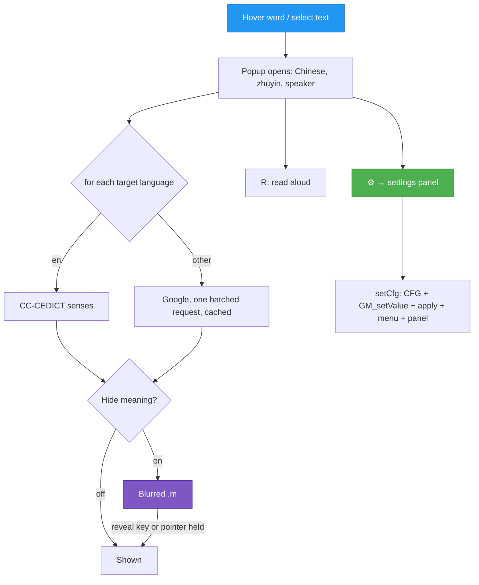

# TASK-002: Target languages, hide-meaning mode and settings panel — progress

Status: **Implemented and tested in headless Chromium (2026-10-17); not yet tried in Violentmonkey.** Everything requested is built: the ⚙ settings panel, the full Google language list with an optional second language, hide-meaning with a held reveal key, and a read-aloud shortcut. The popup also no longer needs `innerHTML`. A Playwright test (33 checks) passes. README and CHANGELOG are updated and the README images regenerated. Not committed.

## Full initial request (verbatim)

> Do two things: Add option to only show translation if some button is pressed (like shift or alt or whatever); Another thing: Add option to translate to a different language. Add icon gear to access the settings in a nice ui to the select cards/hover cards. May need to split the .js file if gets too big, but only after 2k lines. Read docs/tasks/task_template.md first and create task. If any questions, ask me. Now go, start with progress file

> Must support LT language the translation. Single words or sentences, on hover or select

> You misunderstood. Popups may pop, but not show the language for example if I want to hear the sound. Also add shortcut to make sound for the current pop-up.

> Allow for two languages too, allow to do selection of 2

> Also for some reason no audio button if I use this in claude web interface [screenshot: claude.ai in Firefox, hover card for 中文 with "Chinese language" and the two characters' meanings, no speaker button and no zhuyin line]

> Show blurred screenshots too, explain how to use. Allow from maybe more language selections if google translate supports. Update progress file.

> Do settings and other new screenshots in dark mode.

> Maybe no need for "alt" to read? Maybe could be alt-less|?

> Make alt optional

## Read first

- Project rules: never `git stash`, never run `git commit` (print a Suggested commit block instead), temporary files only in `./tmp/`, KISS, one file (`zhuyin-anywhere.user.js`) and no build step, reuse the popup's existing CSS classes and light/dark colours, no backwards compatibility.
- `README.md`: the new sections "Lithuanian and other languages", "Hide the meaning, practise reading", "Settings", and the Keys and Settings tables.
- The pipeline comment at the top of `zhuyin-anywhere.user.js`: steps 6 and 10 and the Hotkeys line.
- `tools/assets/README.md`: how the README images are rendered (the new shots are listed there).
- `docs/tasks/task_001_read_aloud_progress.md`: hover card placement (`place()`, `scheduleHide`), which the settings panel reuses.

## Overview

1. **Settings panel.** A ⚙ on the hover card (top right) and in the translation popup's bar opens a panel with all 15 settings as button groups, selects and a number field. Changes apply right away. The Violentmonkey menu keeps every entry, plus "Settings…".
2. **Target languages.** "Translate to" offers every language Google Translate has (132, English and Lithuanian first). An optional "Second language" is shown under the first in every popup, each line tagged `LT` / `EN`. For non-English languages the card and the word list are translated by Google too: one batched request, cached. English keeps CC-CEDICT.
3. **Hide meaning.** Popups open as usual (Chinese, zhuyin, speaker), but every translation is blurred until the reveal key is held. The key can be Shift (default), Alt or Ctrl. Pressing and holding the blurred text also reveals it.
4. **Read-aloud shortcut.** R reads the open card, or else the translation popup; pressing it again stops. The key acts only while a popup is open and not while typing. The letter is configurable, and Alt is optional (`R` or `Alt+R`).
5. **Trusted Types.** The popup is built with DOM calls, so it also appears on pages that block `innerHTML`.

## User decisions (precise wording)

| Topic | Decision (user's words) |
|---|---|
| Trigger | "Popups may pop, but not show the language for example if I want to hear the sound" → popups always open; only the meaning is hidden |
| Reveal behaviour | "Only while held" |
| Reveal key | "Shift (Recommended)" → default Shift; Alt or Ctrl selectable |
| Sound shortcut | "add shortcut to make sound for the current pop-up" + "Configurable in settings" + "Make alt optional" → one select: a letter (`R`, the default) or Alt + a letter |
| Language | "Must support LT language" … "Single words or sentences, on hover or select" |
| Hover card, other language | "LT only" → no CC-CEDICT senses for a non-English language; with English as one of two languages, the English part is CC-CEDICT |
| Word list | "Lithuanian, one batched request (Recommended)" |
| Two languages | "Allow for two languages too, allow to do selection of 2" → "Translate to" + "Second language" (none by default) |
| Language list | "Allow from maybe more language selections if google translate supports" → read as: offer every Google language. Not more than two at once |
| Violentmonkey menu | "Keep the full menu too" |
| Screenshots | "Show blurred screenshots too, explain how to use" + "Do settings and other new screenshots in dark mode" |
| File size | "split the .js file … only after 2k lines" → 1313 lines, stays one file |

## Decisions needed

None. One open reading: "more language selections" was taken as more languages in the list, not more than two at once. More than two would be a small change, since `langs()` already returns a list.

## Design principles
- **No backwards compatibility** - Clean implementation, update all code in place
- KISS
- Elegant
- One settings table (`SETTINGS`) drives both the panel and the Violentmonkey menu; one `setCfg` saves and applies.
- Everything that shows a meaning shows it in every target language, and carries class `.m` so it can be blurred.

---

## Analysis (before this task)

- `CFG.targetLang` was hard-coded `'en'`. The memory translation cache key ignored the language.
- The hover card and the word list were CC-CEDICT only (English).
- The trigger key was fixed to Alt, and only for the hover card (`gloss: 'alt'`).
- Settings were only reachable as "a → b" cycling entries in the Violentmonkey menu.
- The popup's shadow DOM was built with `innerHTML`. Under Trusted Types (`require-trusted-types-for 'script'`) that throws, and no popup appears at all (reproduced in Chromium, `./tmp/t002/tt.js`).

Solution chosen: a third `.box` (`.set`) in the existing shadow root. Rejected: turning the card itself into settings (fights the card's auto-hide) and a full-page modal (out of style).



**Edge cases**
- The language changes while a Google request is running → the request keeps the language it started with. The answer is cached under that language, and a stale card or popup isn't updated (`stale()`, `reqId`).
- The language, translator, pinyin, hide-meaning or reveal key changes while the translation popup is open → the popup is re-translated in place (`retranslate`).
- `local` translator with a non-English target → that language goes to Google; the "via" line names both.
- First and second language the same → shown once (`langs()` dedups).
- The reveal key is released in another window → `blur` resets it.
- The reveal key is Alt → the Alt keyup is `preventDefault`ed while a popup is open, so Firefox's menu bar stays shut.
- Google merges batched lines → each word is asked on its own (fallback in `translateWords`).
- The card's ⚙ → the card hides and the panel opens where the card was, kept clear of an open translation popup.

**Out of scope**
- More than two languages at once.
- Another source language than Traditional Chinese.
- A non-English dictionary instead of Google for words.

## Subtasks

| ID | Description | Status | File |
|----|-------------|--------|------|
| 002.1 | Config: `targetLang`, `targetLang2`, `hideMeaning`, `revealKey`, `speakKey` | Done | `zhuyin-anywhere.user.js` |
| 002.2 | `translate(text, lang)`, `translateWords(words, lang)` batched, language-keyed caches | Done, tested | `zhuyin-anywhere.user.js` |
| 002.3 | Card, popup and word list in one or two languages, tagged | Done, tested | `zhuyin-anywhere.user.js` |
| 002.4 | Hide meaning (`.m` blur, reveal key and pointer hold), read-aloud key with Alt optional | Done, tested | `zhuyin-anywhere.user.js` |
| 002.5 | ⚙ buttons, settings panel, `SETTINGS` table shared with the menu | Done, tested | `zhuyin-anywhere.user.js` |
| 002.6 | Popup without `innerHTML` (Trusted Types) | Done, tested | `zhuyin-anywhere.user.js` |
| 002.7 | Full Google language list (132) | Done; odd codes (`iw`, `jw`, `mni-Mtei`, `ckb`, `zh-CN`, `gom`…) checked with curl | `zhuyin-anywhere.user.js` |
| 002.8 | README, CHANGELOG, version 0.7.0, pipeline comment | Done | several |
| 002.9 | README images: `languages.png`, `hide-meaning.png`, `settings.png` (dark); `hover`, `select`, `dark` retaken | Done | `tools/assets/`, `docs/img/` |
| 002.10 | Test in Violentmonkey on Firefox and Chrome | Not started (user) | |

## Instructions

- Run `node --check zhuyin-anywhere.user.js`. There is no Node on this machine; use the container (see Gotchas).
- Bump `@version` in the metadata block when behaviour changes, so Violentmonkey picks up the update.
- Add an entry to `CHANGELOG.md` (commit hash, date, changes) under the version it ships in, `Unreleased` if none. Fill in the hash once the user has committed.
- Test in Violentmonkey on Firefox and, when the change touches browser APIs, on Chrome too. A local test page in `./tmp/` opened as `file:///` works: the script matches local files.
- If UI/UX changed, show the specific changes and give paths to screenshots. Keep them in `./tmp/`.
- If UI/UX changed, regenerate the README images: `cd tools/assets && node build.js` (setup in `tools/assets/README.md`), and check that popups still fit their crops.

Automated test: `podman run --rm --ipc=host -v "$PWD":/w:Z -w /w/tools/assets mcr.microsoft.com/playwright:v1.64.1-noble node /w/tmp/t002/test.js`. It fakes Google so that every answer is `<tl>:<line>` and opens the closed shadow root, then checks:
- the English card makes no request,
- the Lithuanian card makes one request for the word and its characters, and the second hover is cached,
- two languages give tagged lines, the word list shows both, and copy takes both lines,
- the ⚙ on the card and on the popup open the panel; select and button changes are saved, applied, and update the menu,
- clearing the second language re-translates the open popup,
- with hide meaning: blurred, sharp while Shift is held, blurred again on release,
- R reads the popup, even with Shift held; with no popup open, R goes to the page; R while typing is ignored; on an open card R reads it and the page doesn't get the key; with `Alt+K` set, Alt+R and plain K do nothing and Alt+K reads,
- Esc closes the panel.

Trusted Types check: `node /w/tmp/t002/tt.js` (same container).

Still to try by hand in Violentmonkey:
1. On a Traditional Chinese page, ⚙ on a card → set "Translate to" Lithuanian → hover a word → LT line; select a sentence → LT translation and LT word list.
2. "Second language" English → both lines, tagged.
3. "Hide meaning" on → blurred; hold Shift → readable; release → blurred; press and hold on blurred text (touch, or mouse) → readable.
4. R with a card open → reads the word; with only the popup open → reads the sentence; again → stops. On YouTube (where letters are player shortcuts), R with no popup still reaches the player.
5. Reveal key Alt with "Word gloss: Alt" → holding Alt opens the card and shows the meaning; Firefox's menu bar doesn't open.
6. Violentmonkey menu → "Settings…" opens the panel at the top right; "Translate to … (change…)" accepts `lt`, `Lithuanian` or a code that isn't in the list.

### Gotchas (learned the hard way)

- Google gtx keeps `\n`-separated words apart: 8 words in, one segment with 8 lines out. zh-TW→lt goes through English (the reply's model ids are `zh_en` and `en2…lt`).
- Single characters translate badly into Lithuanian: 珍 → "Džeinė" (a name), 奶 → "papai", 的 → "iš". Words are fine (銀行 bankas, 夜市 naktinis turgus). That's why the README demo card is 夜市.
- Under Trusted Types, `ShadowRoot.innerHTML` throws as well, and the popup never appears. `<style>.textContent` and DOM calls are allowed.
- No Node or Playwright on this machine. Use `mcr.microsoft.com/playwright:v1.64.1-noble` with podman; the version must match `tools/assets/package-lock.json` (1.64.1), otherwise the browsers are missing.
- Regenerating the README images in the container changes every image slightly (fonts and anti-aliasing). Only the images whose UI changed are kept; the others were reverted with `git checkout`.
- In the user's claude.ai screenshot, the card has no speaker and no zhuyin line. That is the 0.4.1 card exactly (speaker and the always-on zhuyin arrived in 0.5.0), so that browser was most likely running an old install.

## Open points

- The claude.ai report: check which version Violentmonkey has installed in that browser. If it is ≥ 0.5.0 and there is still no speaker, open the browser console on claude.ai and look for `[zhuyin]` errors or CSP messages.
- Behaviour in real Violentmonkey (Firefox content-script sandbox): `pointerdown` on the closed shadow root and the Alt keyup suppression are untested there.

## Log

- 2026-10-17: Read the template and the script; wrote this doc and asked four questions.
- 2026-10-17: User corrected the trigger idea (hide the meaning, not the popup) and chose an LT-only card, a batched word list, the full menu kept, a configurable Alt+letter read-aloud key and Shift to reveal. Checked Google batching with curl.
- 2026-10-17: Implemented the config, the language-aware translation, the card and word list in the target language, hide meaning, the read-aloud key, the settings panel and the menu from `SETTINGS`. Version 0.7.0.
- 2026-10-17: User asked for two languages: added `targetLang2`, tagged lines, word list and card in both.
- 2026-10-17: Set up the Playwright container and wrote `./tmp/t002/test.js`; all 30 checks pass (33 after the read-aloud key change).
- 2026-10-17: User reported no speaker on claude.ai. The screenshot matches the 0.4.1 card. While checking, found that Trusted Types pages block the popup entirely; rebuilt it with DOM calls (`./tmp/t002/tt.js` passes).
- 2026-10-17: README sections, CHANGELOG, `build.js` shots (canned Google answers per language and line, recorded from Google), poster sections.
- 2026-10-17: User asked for blurred screenshots, usage steps, more languages and dark mode: added `hide-meaning.png` with step-by-step usage and the full 132-language list; all new images are in dark mode in `.night` blocks.

- 2026-10-17: User asked to make Alt optional for read aloud: the key is now `R` by default or `Alt+<letter>`, acts only while a popup is open and not while typing, and is consumed then. Test extended to 33 checks; `settings.png` retaken.

## Result

### Where things are

All in `zhuyin-anywhere.user.js` unless noted:

| What | Where |
|---|---|
| New config keys | `:74-86` |
| `LANGS` (132), `langs()`, `translator(lang)`, `viaText`, `langTag` | `:582-605` |
| `google(text, lang)`, `translate(text, lang)`, `translateWords(words, lang)` | `:607-645` |
| Popup built without `innerHTML`; blur, ⚙, panel CSS | `:752-850` |
| Reveal state (`reveal`, `holdHint`) | `:858-861` |
| Word list per language | `:937` |
| Translation popup per language (`showTranslation`) | `:975` |
| Hover card per language (`showGloss`) | `:1031` |
| Reveal and read-aloud keys, `typing()` | `:1178-1213` |
| `SETTINGS`, `setCfg`, `renderSettings`, `openSettings`, `buildMenu` | `:1210-1300` |
| New shots and canned answers | `tools/assets/build.js` |
| New poster sections, `.night` class | `tools/assets/poster.html` |

### Differences from the plan

- The trigger became "hide the meaning while the key isn't held" instead of "open the popup only with a key" (user's correction).
- A second language and the full Google list were added on request.
- The Trusted Types fix wasn't planned; it came up while checking the claude.ai report.

### Checked

- `node --check` passes (Node 22 in a container).
- `./tmp/t002/test.js`: 33 of 33 checks pass in headless Chromium.
- `./tmp/t002/tt.js`: the popup opens under `require-trusted-types-for 'script'`.
- Google codes checked with curl: `iw`, `he`, `jw`, `mni-Mtei`, `ckb`, `zh-CN`, `gom`, `kri`, `lus`, `nso`, `doi`, `bm`.
- Screenshots: `./tmp/t002/*.png`, plus `docs/img/languages.png`, `docs/img/hide-meaning.png`, `docs/img/settings.png`.
- Not checked: Violentmonkey itself, Firefox, touch.

## Suggested commit

```
git commit \
  -m "TASK-002 feat(popup): Add settings panel, target languages and hide-meaning mode" \
  -m "Why: Read Taiwanese pages in Lithuanian (or any language, or two at once), practise by hiding meanings until a key is held, and change settings from the popups." \
  -m "- Settings panel behind a gear on the word card and translation popup; one SETTINGS table drives it and the Violentmonkey menu
- Translate to any of Google's 132 languages plus an optional second language, tagged; card and word list use Google (batched, cached) except for English
- Hide meaning: translations blurred until Shift/Alt/Ctrl is held or the text is pressed
- R (configurable, Alt optional) reads the open card or popup aloud
- Popup built without innerHTML, so it opens on Trusted Types pages
- README sections, usage steps and dark-mode images for languages, hide meaning and settings"
```
