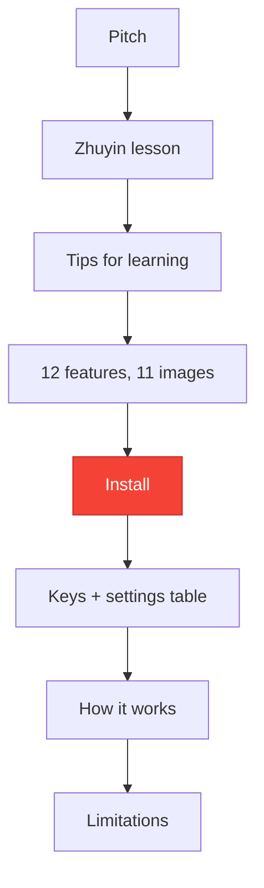
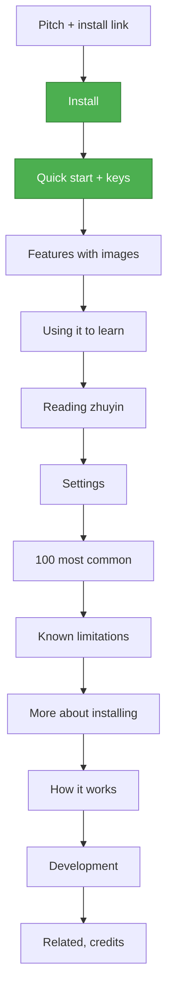

# TASK-009: README in the order a reader needs it — progress

Status: **Done (2026-10-26). Not committed.** `README.md` follows the new order, opens with a new hero image (the name and a browser window with the 夜市 card), an Install link and a contents line. The same image at 1280×640 is `docs/img/social-preview.png`, to upload by hand as the repo's social preview. Both are rendered by `sh tools/run.sh images`.

## Full initial request (verbatim)

> This is a userscript for web pages to display zhuyin near trad characters. Don't look at README.md yet, tell me, what kind of structure should README.md follow? Installation, examples, explaining zhuyin, tech details etc., what's the correct structure? Where to put the menu (guide or shit)? Think of it first, provide me your thoughts

> Great, I think our README.md is bad. First create progress file of proper structure for README.md and then restructure it

> How can we also make image appear in project overview? Also, add the contents and link to install section somewhere up, after first images. Maybe create a nice new image demonstrating this that we could use as hero, maybe saying zhuyin anywhere in mandarin with translation card poping up and stuff. Gimme mockups first.

> Also give me text piece that I should put in About section in GH pls, a few sentences at most

> Tbh I'm not sure if I'm loving the green grid lines, they make b much harder to read. Color one or two characters in the mandarin text below too to make it visible. I hate C, A is meh-okayish. Redo v2 of B and make two new versions.

> e - too small, B ok, D could be good. Let's do D. Adnd maybe I can add it as socials img, wdyt?

> Then gimme 1280×640px img to upload to gh, should be in docs/img too

> And gh says to leave 40px border around content to make sure nothing gets cropped. Pls update social-preview, maybe no need for more text below. Do v3 examples with less content and bigger content so it is clearer and make it prettier. gl hf

> Make pop-up bigger in all 3, do proper borders like tmp/repository-open-graph-template.png

> Nah, do main name on left, just make pop-up move a bit more to the right below the text pls

> in V3 move text box to the right, name and other section to the left

> I like v4 v2, just make Zhuyin Anywhere name bigger

## Read first

- Project rules: never `git stash`, never run `git commit` (print a Suggested commit block instead), temporary files only in `./tmp/`, KISS, no backwards compatibility.
- `README.md`: the file this task reorders.
- `tools/README.md`, `tools/assets/README.md`: the README images in `docs/img/` are rendered by `sh tools/run.sh images`; the hero is stage 2 of `tools/assets/build.js`.

## Overview

1. Reorder `README.md` by what the reader is trying to do: what it is → install → first use → what it can do → how to learn with it → reference (zhuyin primer, settings, limitations) → internals and development → credits. The text and images stay; sections move, the two settings sections become one, and install details that only some readers need move down.
2. A new top image (`docs/img/hero.png`: the name, and a browser window with zhuyin and the card for 夜市) that doubles as the GitHub social preview (`docs/img/social-preview.png`, 1280×640), with the Install link and a contents line under it.

## User decisions (precise wording)

| Topic | Decision (user's words) |
|---|---|
| Structure | "Great" to the proposed order: pitch + image, features, install near the top, usage, settings reference, FAQ / limitations, short zhuyin explanation, how it works, development, credits |
| Scope | "restructure it" → move and merge sections; no new features documented |
| Hero | "I like v4 v2, just make Zhuyin Anywhere name bigger": name on the left at 76 px, one browser window, big card (175 %), no practice grid ("green grid lines ... make b much harder to read"), 茶 tinted |
| Safe area | "do proper borders like tmp/repository-open-graph-template.png" → everything inside x 80–1200, y 80–560 |
| Social preview | "gimme 1280×640px img to upload to gh, should be in docs/img too" → `docs/img/social-preview.png` |
| Top of README | "add the contents and link to install section somewhere up, after first images" |

## Decisions needed

None.

## Design principles
- **No backwards compatibility** - Clean implementation, update all code in place
- KISS
- Elegant
- The install link is reachable without scrolling past the feature tour.
- One place for each thing: settings once, install details once.

---

## Current analysis

`README.md` (326 lines), section order today:

| Lines | Section |
|---|---|
| 1–16 | Title, hero, pitch, four bullets |
| 18–34 | Never seen zhuyin before? (primer, two images, tone table) |
| 36–38 | See how the tool works (one paragraph) |
| 40–50 | Using it to learn (tips) |
| 52–181 | Features: 12 subsections, 11 images, including **Settings** (148–152) and **What's new after an update** (154–158) |
| 183–213 | Install: three steps, other ways (manual URL, branch, local clone), local `file://` pages, what is downloaded |
| 215–278 | Usage: keys, settings table, the 100 most common characters |
| 280–296 | How it works |
| 298–309 | Known limitations |
| 311–326 | Related, Credits and license, Images in this README |

### Current Flow



Issues:
- **Install is about two thirds down the page**, after a zhuyin lesson and eleven screenshots. Readers who already want it have to hunt for it.
- The README opens with a zhuyin lesson, which most readers don't need, before saying how to get the script.
- "Using it to learn" comes before the features its tips refer to (Hide meaning, Most common, My characters).
- Settings are explained twice: Features › Settings (how to open the panel) and Usage › Settings (the table).
- Install mixes the three steps everyone needs with branch installs, local clones and the `file://` setup that few readers need.
- There is no short "first use" part: the keys table sits in the reference half, far from Install.
- "What's new after an update" is about updates, not a feature to try.

### What needs improving



### Chosen solution implementation details

**Chosen: reorder and merge, keep the wording.**

- **Why this over a rewrite**: the content is accurate and the images are built from the real script; what's wrong is the order.

**New structure**

1. **Zhuyin Anywhere**: hero, the 注音 line, pitch, four bullets, browsers. Adds an **Install** link and a "New to zhuyin? → Reading zhuyin" link.
2. **Install**: the three steps, then one line on the dictionaries downloaded once (details in 11).
3. **Quick start**: the "See how the tool works" paragraph, ⚙ opens the settings, and the **Keys** table.
4. **Features**: the feature subsections in reading order: zhuyin on every page, it reads words, point at a word, select text, your own language, what a character is made of, tint, hide meaning, dark popups, compact mode. Features › Settings moves to 7, What's new after an update to 10.
5. **Using it to learn**: the tips, now after the features they refer to.
6. **Reading zhuyin**: the primer (former "Never seen zhuyin before?"), unchanged.
7. **Settings**: how to open the panel, its screenshot, the Violentmonkey menu note, then the table.
8. **The 100 most common characters**: unchanged; the tip's link says where it is.
9. **Known limitations**: unchanged.
10. **More about installing**: other ways to install, local files, updates (former "What's new after an update"), what is downloaded.
11. **How it works**: unchanged.
12. **Development**: former "Images in this README", plus a pointer to `docs/tasks/` and `CHANGELOG.md`.
13. **Related**, **Credits and license**: unchanged.

**Edge cases**
- In-page links: `#the-100-most-common-characters` keeps its heading; the tip that points at it no longer says "at the end of Usage".
- GitHub builds the table of contents from headings, so none is written by hand.

**Files to modify**

| File | Change | Status |
|---|---|---|
| `README.md` | Reorder and merge sections as above; new hero, Install link, contents line | Done |
| `tools/assets/hero.html` | The hero page, 1280×640 | Done |
| `tools/assets/build.js` | Stage 2 `heroImage()`; old 注音 crop (`'hero'` in `README_IMAGES`) dropped | Done |
| `tools/assets/README.md` | `hero.html` in Files, stage 2 described | Done |
| `docs/img/hero.png`, `docs/img/social-preview.png` | Rendered | Done |

**Out of scope**
- New screenshots, rewording sections, changes to the script.

## Subtasks

| ID | Description | Status | File |
|----|-------------|--------|------|
| 9.1 | Progress file with the new structure | Done | `docs/tasks/task_009_readme_structure_progress.md` |
| 9.2 | Restructure the README | Done | `README.md` |
| 9.3 | Hero / social preview mockups (v1 A, B, C; v2 B, D, E) | Done, D chosen | `tmp/hero/` |
| 9.4 | Hero in the image build, README top with Install link and contents | Done | `tools/assets/`, `README.md` |
| 9.5 | v3/v4 mockups in GitHub's safe area, v4 v2 with a bigger name into the build | Done | `tmp/hero/`, `tools/assets/hero.html` |

## Log

- 2026-10-25: Structure agreed in chat; progress file written.
- 2026-10-25: README reordered by line ranges with a script, so the text was moved, not retyped. Checked by diffing the sorted non-blank lines of the old and new README.
- 2026-10-26: Hero / social-preview mockups (1280×640, real script in headless Chromium, title 到處注音 "zhuyin everywhere", card on 到處): v1 A workbook, B browser, C night in `tmp/hero/v1/` (sources `tmp/hero/hero.html`, `render.js`); C rejected, A "meh". v2 without the grid, 行 茶 / 夜 珠 tinted as My characters: B browser + card, D before/after, E banner + translation box, in `tmp/hero/v2-*.png` (`hero2.html`, `render2.js`). D chosen.
- 2026-10-26: D moved into the build as `tools/assets/hero.html` + `heroImage()` → `docs/img/hero.png` (2×, 204 KB) and `social-preview.png` (1280×640, 97 KB). README top: hero, Install link, pitch, 注音 line, contents. The other README images came out of the rebuild shifted by a fraction of a pixel with the same content (checked old/new/diff for `compact.png`) and were checked out again.
- 2026-10-26: v3 mockups for GitHub's 40 px safe margin (all content inside x 40–1240, y 40–600, shadows included), less and bigger text, rounded windows: v1 before/after with the card on 夜市, v2 name + one window, v3 typographic 到處注音 sheet with the card for 到處 and 音 tinted. `tmp/hero/v3-v*.png` (`hero3.html`, `render3.js`, `SAFE=1` draws the margin). A card on a word below the middle of the image opens upwards (that's `place()`), so the annotated line has to sit in the top half.
- 2026-10-26: GitHub's template (`tmp/repository-open-graph-template.png`) has its guide lines at 80 px, not 40: safe area x 80–1200, y 80–560. v4 mockups in that area with bigger cards (popup size 150–175 %): v1 before/after (name on top, labels in the window bars), v2 name left + one window, v3 name left + 到處注音 sheet right. `place()` keeps room for a card's widest size, which pushes a big card left over the other window or the name, so in v1/v2 the card is moved after it opens to start at its word (staging, like the canned translation). `render4.js` prints each card's box and checks it against the safe area: all inside. `tmp/hero/v4-v*.png` clean, `tmp/hero/guide/` with the safe-area line.
- 2026-10-26: v4 v2 chosen, name 62 → 76 px. Moved into `tools/assets/hero.html` and `heroImage()` (popup 175 %, 茶 tinted, card lined up with 夜, safe-area check). Rebuilt: `hero.png` 160 KB, `social-preview.png` 1280×640, 77 KB; checked against the template's guide lines. README alt text updated; the 到處注音 sentence removed. The other images again differed only by sub-pixel shifts and were checked out.

## Result

### Where things are

| Section | Came from |
|---|---|
| Intro | New hero image (name + browser window with the 夜市 card), Install link and link to Reading zhuyin, pitch, the 注音 line, contents line |
| Install | The three steps, plus one line pointing to More about installing |
| Quick start | "See how the tool works", a line on ⚙, and Usage › Keys |
| Features | Same subsections; "It reads words" moved up after "Zhuyin on every page", "Hide meaning" after "Tint" |
| Using it to learn | Was a subsection before Features; the top-100 link now says "below" |
| Reading zhuyin | "Never seen zhuyin before?" |
| Settings | Features › Settings (how to open, screenshot) + Usage › Settings table |
| More about installing | Install › Other ways, Local files, the downloaded dictionaries, and Features › What's new after an update (as Updates) |
| Development | "Images in this README", plus a line on `docs/tasks/` and `CHANGELOG.md` |

### Differences from the plan

- The old floating 注音 image is gone; the new hero replaces it, and its crop was removed from `README_IMAGES`.
- The hero's card is moved after it opens to start under 夜 (staging, noted in `build.js` and `tools/assets/README.md`): at 175 % the script would keep it further left, over the name.
- GitHub's safe area is 80 px from each edge (the template's lines), not the 40 px the template's text suggests.
- A contents line after all, because the user asked for one, although GitHub has its own outline button.

### Not done here

- Uploading the social preview: repo Settings → General → Social preview → Edit → Upload an image → `docs/img/social-preview.png`. There is no API for it.
- GitHub About text and topics were given in chat.

### Checked

- Every non-blank line of the old README is in the new one, apart from the renamed headings (`## Usage`, `### Settings (⚙ on a popup…)`, `## See how the tool works`, `## Never seen zhuyin before?`, `## Images in this README`, `### What's new after an update`).
- In-page links: `#install`, `#reading-zhuyin`, `#settings`, `#more-about-installing`, `#the-100-most-common-characters` all match a heading. "Paste the raw link above" still has the link above it (in Install).
- No other file links into README anchors. The contents line's 13 anchors match the 13 `##` headings.
- `hero.png` is 2560×1280, `social-preview.png` 1280×640 and 77 KB (GitHub's limit is 1 MB); every element and the card inside x 80–1200, y 80–560.

## Commit suggestion

```
git commit \
  -m "TASK-009 docs(readme): Put install first, add a hero image and social preview" \
  -m "Why: install was two thirds down the page, after a zhuyin lesson and eleven screenshots, and the repo had no preview image." \
  -m "- Order: intro, install, quick start + keys, features, learning tips, reading zhuyin, settings, top 100, limitations, more about installing, how it works, development, credits
- Settings explained once; branch installs, local files, downloads and update notes moved below the limitations
- Hero: the name and a browser window with zhuyin, 茶 tinted and the 夜市 card open, inside GitHub's safe area (tools/assets/hero.html, stage 2 of build.js)
- docs/img/social-preview.png at 1280x640 for the repo's social preview
- Install link and contents line under the hero"
```
